<p align="left">
  
</p>

# StressOFF

**A multimodal wellness app that reads your wearable data, meal photos and calendar to explain your stress and nutrition, then talks it through with an AI coach.**


---

## Overview

Stress, sleep, food and schedule are usually tracked in separate apps, so nobody connects a bad night, a packed afternoon and a skipped lunch. StressOFF brings those signals into one place:

- **Physiological data** from a smartwatch (heart rate, HRV, SpO2, steps, sleep) stored in Firestore.
- **Meal photos** analyzed by a vision-language model for dish, ingredients, macros and allergens.
- **The device calendar**, so advice adapts to what the user actually has to do today.
- **A conversational coach** that streams personalized answers token by token.

It targets people who want practical, day-to-day guidance on stress and eating habits without manually logging everything.

### Challenge context


StressOFF was built for the **IEEE Computer Society Tunisian Annual Meeting 2.0 (CSTAM 2.0) Technical Challenge**. The brief was to build a cloud-native, GenAI-powered mobile or wearable app for personalized health and nutrition guidance, with attention to privacy, ethical AI use and scalable cloud infrastructure.

---

## Key features

- **Authentication and profile**: email/password and Google Sign-In through Firebase Auth; profile (gender, weight, height, goal, allergies) and profile photo stored in Firestore and Firebase Storage.
- **Smart meal analysis**: snap a photo, get dish name, ingredients, calories, proteins, carbs, fats, fibers, personalized advice and detected allergens. Two modes: *Meal Analysis* (saved to Firestore) and *Quick Analysis* (not saved).
- **Daily nutrition summary**: aggregates the day's saved meals, compares them with daily targets and returns global advice and recommendations.
- **Health monitoring and alerts**: daily stats (resting HR, median HRV, steps, calories, active minutes, SpO2, sleep) with rule-based alerts and local push notifications.
- **Stress index**: a 0 to 100 score computed in the app from heart rate, sleep quality and activity, shown as Low / Moderate / High with tips and a daily quote.
- **Calendar-aware recommendations**: today's events are read from the device calendar and each one gets focus practices, a timed nutrition suggestion and a purpose statement.
- **AI coach chat**: streaming chat over Server-Sent Events, with conversation history, profile context and optional text-to-speech playback.
- **Meal history**: browse past analyses and daily summaries.

| Login / Sign up | Calendar | Stress analysis | Health alerts |
|:---:|:---:|:---:|:---:|
| 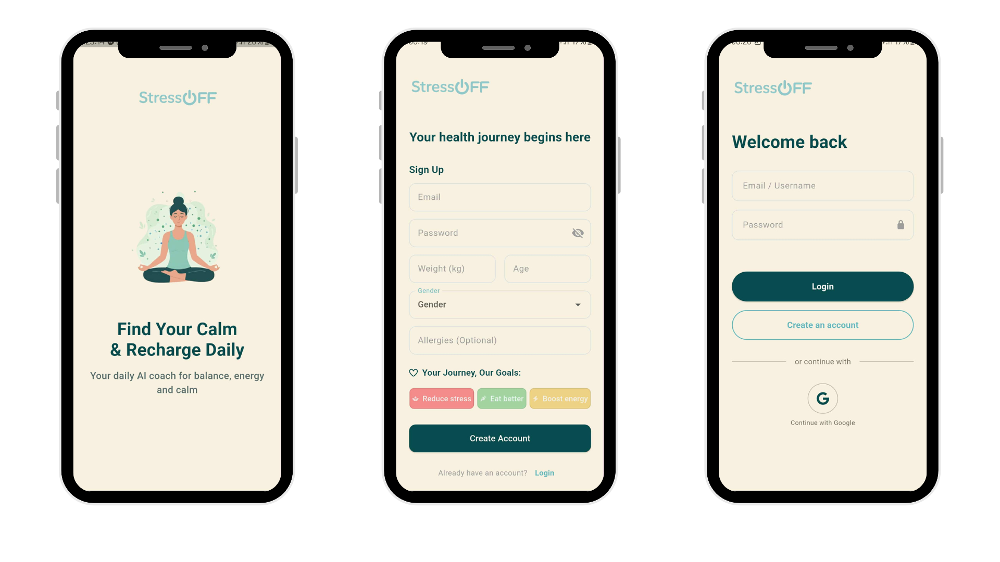 | 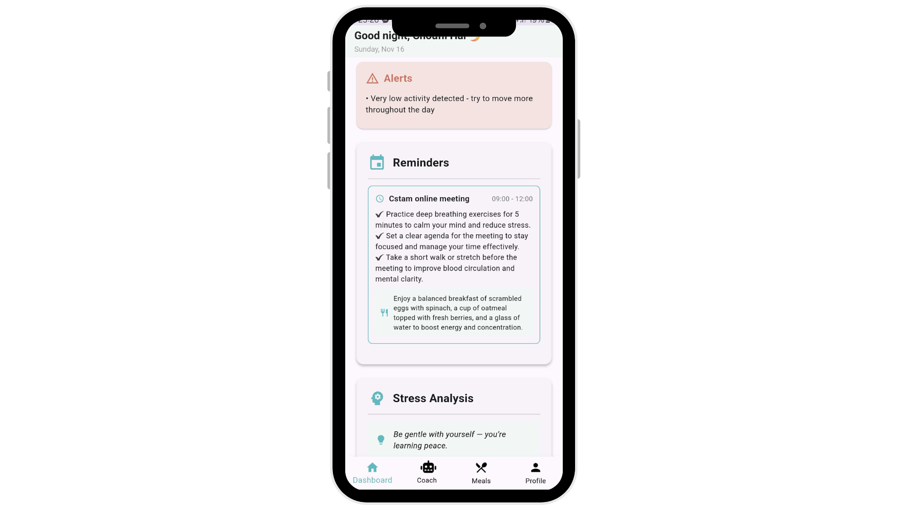 | 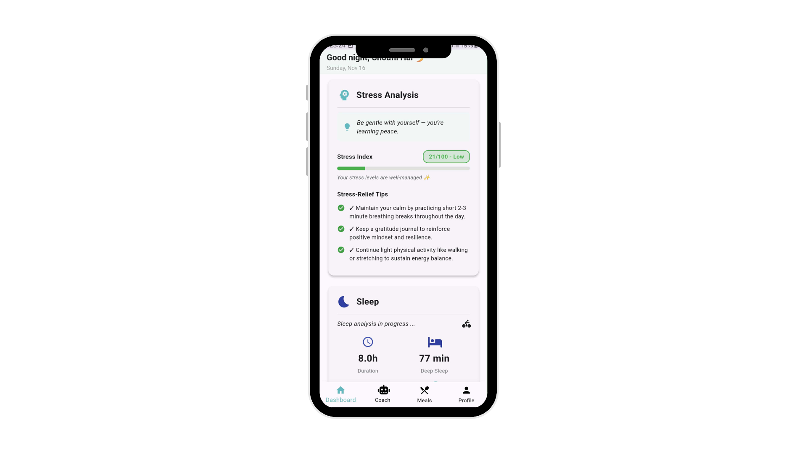 | 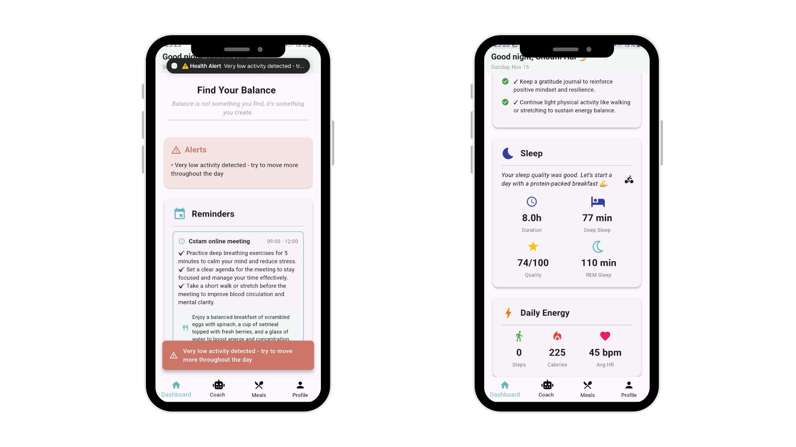 |

| Daily summary | AI coach | Meal analysis | History | Profile |
|:---:|:---:|:---:|:---:|:---:|
| 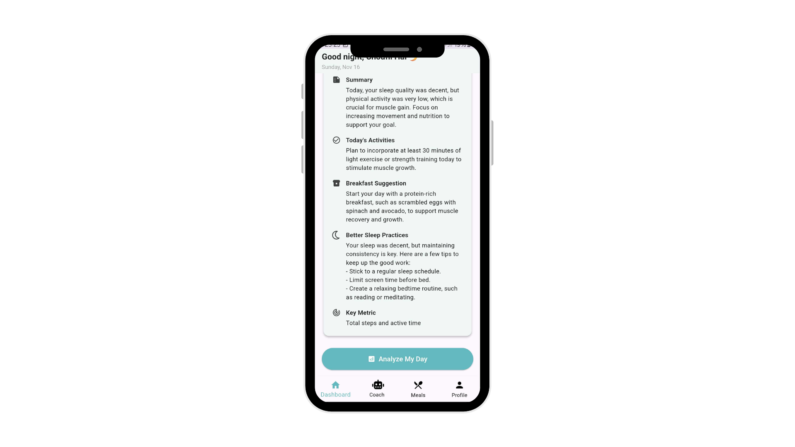 | 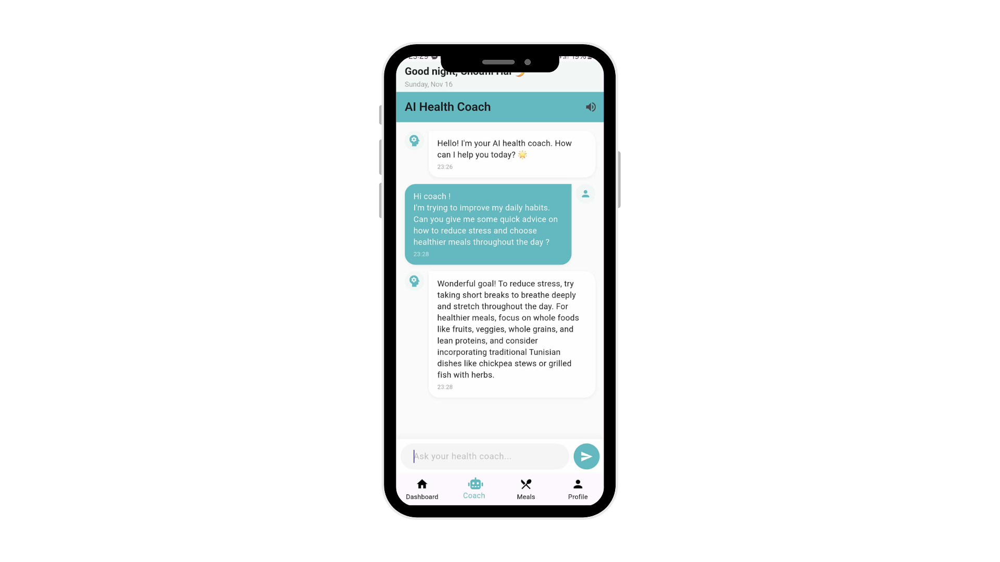 | 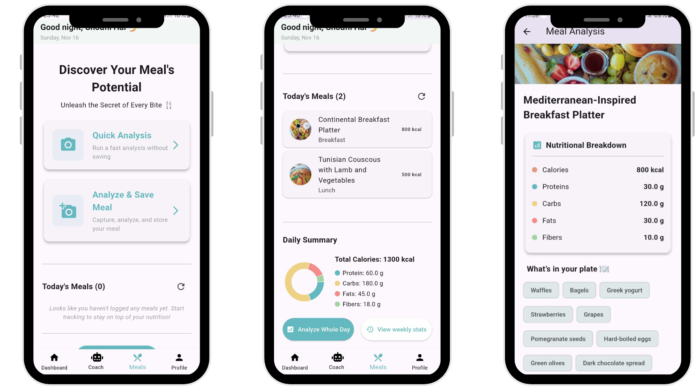 | 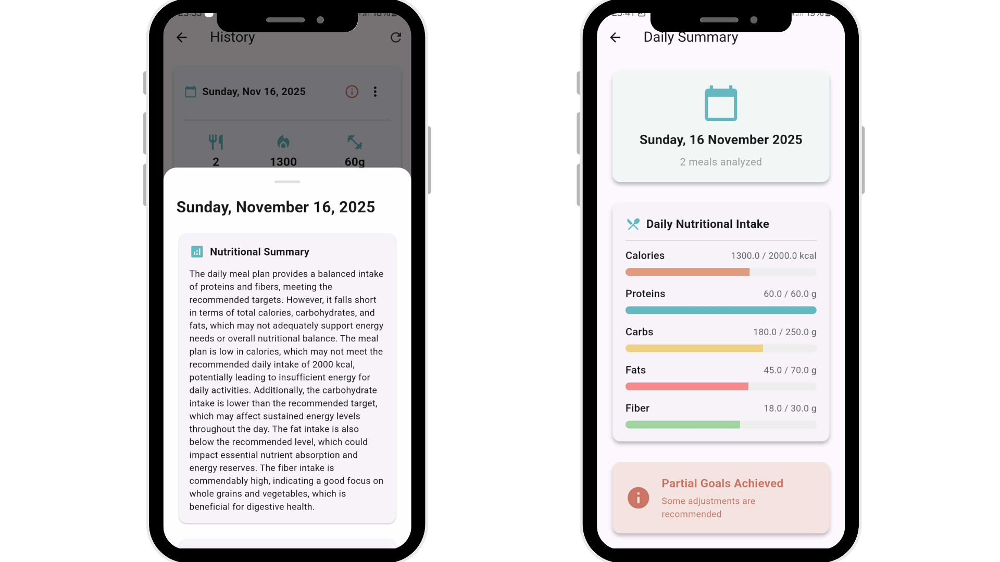 | 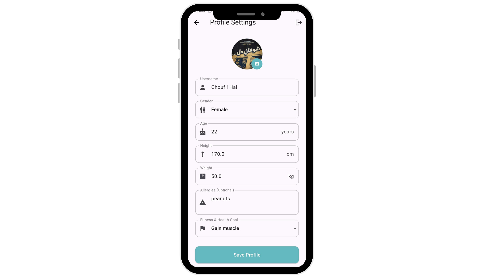 |

---

## Architecture

The Flutter app talks directly to Firebase for identity and data, and to four stateless FastAPI microservices for AI work. Each service is a separate Docker image deployed as its own Azure Container Instance, and each calls OpenRouter for model inference. A Python smartwatch simulator feeds realistic health data into Firestore.

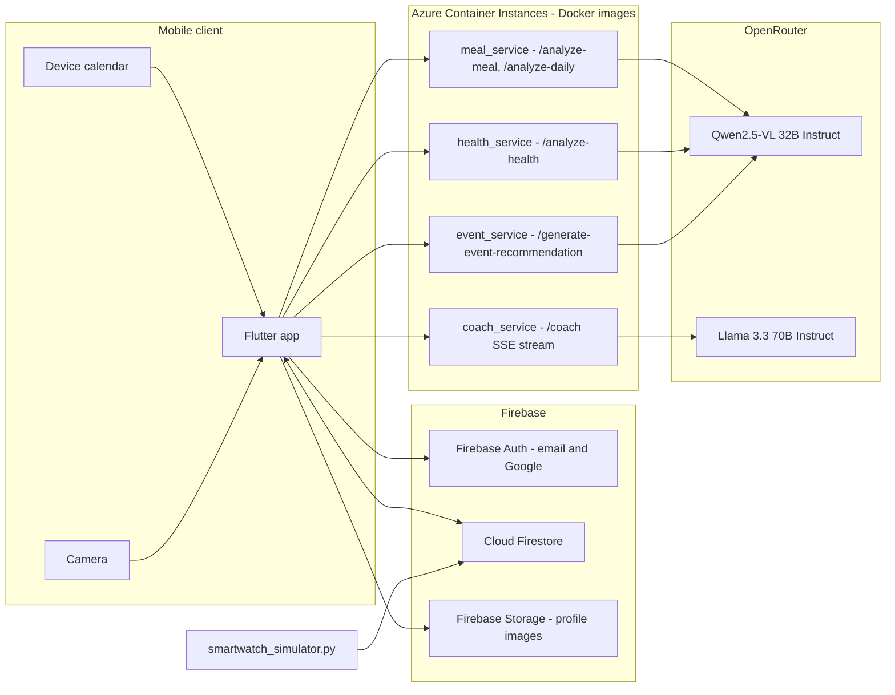

### Services

| Service | Purpose | Model (via OpenRouter) | Output handling |
|---|---|---|---|
| `meal_service` | Meal photo analysis and daily nutrition summary | `qwen/qwen2.5-vl-32b-instruct:free` | Image downscaled to 800 px JPEG; JSON mode; daily totals computed server-side; AI fields normalized to strings |
| `coach_service` | Conversational wellness coach | `meta-llama/llama-3.3-70b-instruct:free` | Upstream stream re-emitted as SSE `data:` events, errors sent in-stream |
| `health_service` | Daily health analysis and alerts | `qwen/qwen2.5-vl-32b-instruct:free` | Stats, stress level (0 to 10) and alerts computed deterministically before the LLM call; JSON mode |
| `event_service` | Recommendations for calendar events | `qwen/qwen2.5-vl-32b-instruct:free` | JSON mode; validated with a Pydantic `response_model` |

All four share Pydantic request models and helpers from [`backend/common`](backend/common). Every service returns `500` if `OPENROUTER_API_KEY` is missing and `502` on upstream model errors; the meal service maps OpenRouter rate limits to `429`.

### Sequence: meal photo analysis

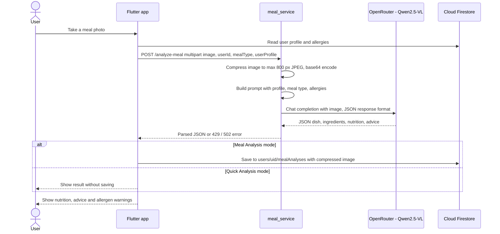

### Sequence: streaming coach chat

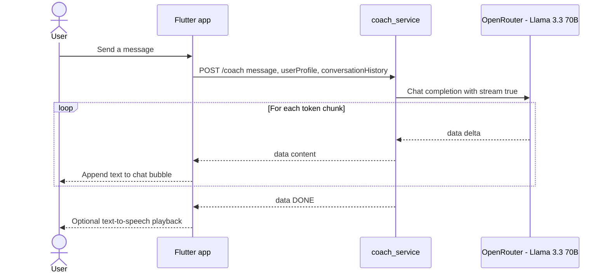

<details>
<summary>Original workflow diagram</summary>
<p align="center">
  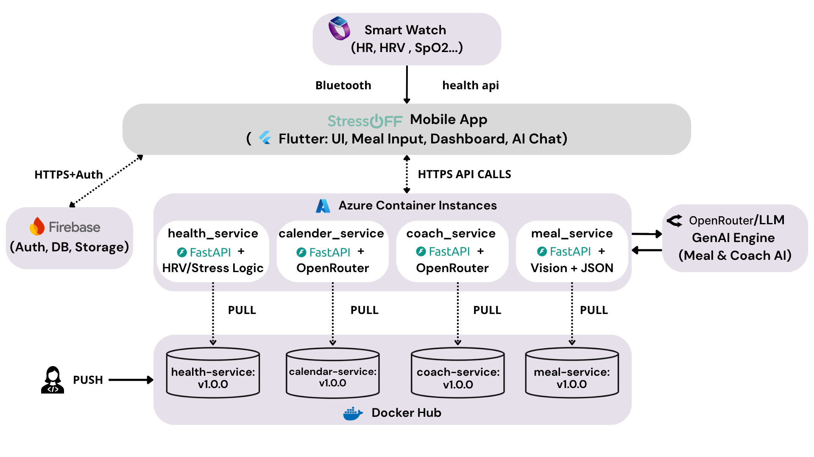
</p>
</details>

---

## Tech stack

| Layer | Technology |
|---|---|
| Mobile app | Flutter (Dart SDK >= 3.3), `http`, `fl_chart`, `image_picker`, `device_calendar`, `flutter_local_notifications`, `flutter_tts` |
| Auth and data | Firebase Auth (email/password, Google Sign-In), Cloud Firestore, Firebase Storage |
| Backend | Python 3.12, FastAPI 0.115, Uvicorn, Pydantic 2, Requests, Pillow |
| AI models | OpenRouter: Qwen2.5-VL 32B Instruct (vision and text), Llama 3.3 70B Instruct (chat) |
| Containers | Docker, one `python:3.12-slim` image per service |
| Cloud | Azure Container Instances, images pulled from Docker Hub |
| Data simulation | `firebase-admin` smartwatch simulator |

---

## Getting started

### Prerequisites

- Python 3.12 and `pip`
- Flutter SDK with Dart >= 3.3, plus Android Studio or Xcode
- A Firebase project with Authentication (email/password and Google), Firestore and Storage enabled
- An [OpenRouter](https://openrouter.ai) API key
- Docker, and the Azure CLI for deployment

### 1. Clone

```bash
git clone https://github.com/yessineabdelmaksoud/StressOFF-app.git
cd StressOFF-app
```

### 2. Configuration

Backend services read a single environment variable:

| Variable | Used by | Required | Description |
|---|---|---|---|
| `OPENROUTER_API_KEY` | all four services | Yes | OpenRouter API key used for every model call |

The Flutter app reads service URLs at build time via `--dart-define` (see [`lib/services/api_config.dart`](lib/services/api_config.dart)):

| Define | Default |
|---|---|
| `MEAL_SERVICE_URL` | Azure meal service on port 8000 |
| `COACH_SERVICE_URL` | Azure coach service on port 8000 |
| `HEALTH_SERVICE_URL` | Azure health service on port 8000 |
| `EVENT_SERVICE_URL` | Azure event service on port 8003 |

Firebase credentials are not committed (`.gitignore` excludes `google-services.json`, `GoogleService-Info.plist` and `.env` files). `lib/main.dart` imports `firebase_options.dart`, which you generate for your own project:

```bash
dart pub global activate flutterfire_cli
flutterfire configure
```

### 3. Run the backend locally

Run from the repository root so the `backend.*` package imports resolve.

```bash
python -m venv .venv
source .venv/bin/activate
pip install -r backend/requirements.txt
export OPENROUTER_API_KEY=<your-openrouter-key>

uvicorn backend.meal_service.main:app   --host 0.0.0.0 --port 8000
uvicorn backend.coach_service.main:app  --host 0.0.0.0 --port 8001
uvicorn backend.health_service.main:app --host 0.0.0.0 --port 8002
uvicorn backend.event_service.main:app  --host 0.0.0.0 --port 8003
```

Run each `uvicorn` command in its own terminal. Interactive docs are at `http://127.0.0.1:<port>/docs`.

On Windows, [`backend/start.ps1`](backend/start.ps1) creates a venv, installs a service's requirements and starts it (meal on 8000, coach on 8001, health on 8002):

```powershell
.\backend\start.ps1 -Service meal
```

### 4. Simulate smartwatch data (optional)

[`backend/smartwatch_simulator.py`](backend/smartwatch_simulator.py) generates circadian-shaped heart rate, HRV, SpO2, steps and calories every minute, plus nightly sleep data, and writes them to `users/{uid}/health_metrics` and `users/{uid}/sleep_data`.

1. Download a Firebase service account key and save it as `serviceAccountKey.json` in the working directory (never commit it).
2. Set `USER_ID` at the top of the script to the Firebase UID of your test user.
3. Run it:

```bash
python backend/smartwatch_simulator.py
```

### 5. Run the Flutter app

```bash
flutter pub get
flutter run \
  --dart-define=MEAL_SERVICE_URL=http://10.0.2.2:8000 \
  --dart-define=COACH_SERVICE_URL=http://10.0.2.2:8001 \
  --dart-define=HEALTH_SERVICE_URL=http://10.0.2.2:8002 \
  --dart-define=EVENT_SERVICE_URL=http://10.0.2.2:8003
```

`10.0.2.2` reaches the host machine from the Android emulator; use your machine's LAN IP on a physical device. Omit the defines to use the deployed Azure endpoints.

### 6. Docker

Each Dockerfile copies `backend/common` and its service folder, so build from the repository root:

```bash
docker build -f backend/meal_service/Dockerfile   -t stressoff/meal-service .
docker build -f backend/coach_service/Dockerfile  -t stressoff/coach-service .
docker build -f backend/health_service/Dockerfile -t stressoff/health-service .
docker build -f backend/event_service/Dockerfile  -t stressoff/event-service .

docker run --rm -p 8000:8000 -e OPENROUTER_API_KEY=<your-openrouter-key> stressoff/meal-service
```

Every container listens on port 8000 internally; map it to different host ports to run several at once (for example `-p 8001:8000` for the coach).

### 7. Tests

The repository contains only the default Flutter template test in [`test/widget_test.dart`](test/widget_test.dart), which still targets the counter app and does not match the current UI. There are no backend tests yet. Static analysis is configured through [`analysis_options.yaml`](analysis_options.yaml):

```bash
flutter analyze
```

---

## API reference

All endpoints accept and return JSON unless noted. CORS is open (`*`) on every service.

### meal_service

| Method | Path | Body | Response |
|---|---|---|---|
| `POST` | `/analyze-meal` | `multipart/form-data`: `image` (file), `userId`, optional `mealType` (`breakfast`, `lunch`, `dinner`, `snack`), optional `userProfile` (JSON string) | `dishName`, `ingredients[]`, `nutrition{calories, proteins, carbs, fats, fibers}`, `healthAdvice`, `recommendation`, `allergiesDetected[]` |
| `POST` | `/analyze-daily` | `userId`, `date`, `meals[]` (meal analyses) | `id`, `userId`, `date`, `mealAnalysisIds[]`, `totalNutrition{...}`, `globalAdvice`, `recommendations`, `needsMet` |
| `GET` | `/` | | Service status and endpoint list |

### coach_service

| Method | Path | Body | Response |
|---|---|---|---|
| `POST` | `/coach` | `userId`, `message`, optional `userProfile`, optional `conversationHistory[]` (`{role, content}`) | `text/event-stream`: `data: {"content": "..."}` chunks, `data: {"error": "..."}` on failure, then `data: [DONE]` |
| `GET` | `/` | | Service status and endpoint list |

### health_service

| Method | Path | Body | Response |
|---|---|---|---|
| `POST` | `/analyze-health` | `userId`, `date`, `metrics[]` (`timestamp`, `heartRate`, `restingHeartRate`, `hrv`, `steps`, `calories`, `activeMinutes`, optional `spo2`), optional `sleepData`, optional `userProfile` | `summary`, `action`, `breakfastSuggestion`, `indicatorToWatch`, `sleepRemark`, `sleepPractices`, `alerts[]`, `dailyStats{avgRestingHR, medianHRV, totalSteps, totalCalories, totalActiveMinutes, avgSpO2, stressLevel}` |
| `GET` | `/` | | Service status and endpoint list |

### event_service

| Method | Path | Body | Response |
|---|---|---|---|
| `POST` | `/generate-event-recommendation` | `eventTitle`, `startTime`, `endTime` (ISO 8601) | `eventTitle`, `eventTime`, `practices`, `nutritionSuggestion`, `purpose` |
| `GET` | `/health` | | `status`, `service`, `openrouter_configured` |
| `GET` | `/` | | Service info and endpoint list |

More detail on the event service is in [`backend/event_service/README.md`](backend/event_service/README.md).

---

## Project structure

```text
StressOFF-app/
├── backend/
│   ├── common/                 # Shared Pydantic models and helpers (image compression, prompts)
│   ├── meal_service/           # main.py, Dockerfile, requirements.txt
│   ├── coach_service/          # main.py, Dockerfile, requirements.txt
│   ├── health_service/         # main.py, Dockerfile, requirements.txt
│   ├── event_service/          # main.py, Dockerfile, requirements.txt, README.md
│   ├── smartwatch_simulator.py # Writes simulated wearable data to Firestore
│   ├── start.ps1               # Local launcher for meal / coach / health
│   └── requirements.txt        # Combined backend + simulator dependencies
├── lib/
│   ├── main.dart               # Firebase init, notifications, app entry
│   ├── models/                 # Health and meal data models
│   ├── pages/                  # Auth, home, healthcare, meal, coach, history, settings
│   ├── services/               # API clients, Firebase, calendar, api_config.dart
│   └── widgets/                # Daily summary meals chart
├── assets/images/              # Logo and screenshots
├── android/  ios/  web/  ...   # Flutter platform projects
├── test/widget_test.dart
└── pubspec.yaml
```

---

## Deployment

The services were deployed as individual Azure Container Instances in `norwayeast`, with images hosted on Docker Hub.

```bash
# Build and push (repeat per service)
docker build -f backend/coach_service/Dockerfile -t <dockerhub-user>/coach-service:v1.0.0 .
docker login --username <dockerhub-user>
docker push <dockerhub-user>/coach-service:v1.0.0

# Create the container group
az login
az account set --subscription <subscription-id>
az group create --name stress-rg --location norwayeast

az container create \
  --resource-group stress-rg \
  --name coach-service-ci \
  --image <dockerhub-user>/coach-service:v1.0.0 \
  --dns-name-label <unique-dns-label> \
  --ports 8000 \
  --registry-login-server index.docker.io \
  --registry-username <dockerhub-user> \
  --registry-password <dockerhub-token> \
  --secure-environment-variables OPENROUTER_API_KEY=<your-openrouter-key> \
  --os-type Linux --cpu 1 --memory 1.5 \
  --location norwayeast
```

Each service becomes reachable at `http://<dns-label>.norwayeast.azurecontainer.io:8000`. Point the app at those URLs with `--dart-define` or by updating the defaults in `lib/services/api_config.dart`. Logs are available with `az container logs --resource-group stress-rg --name coach-service-ci`.

---

## Limitations and roadmap

StressOFF is a challenge prototype. Known gaps, all visible in the code:

- **Backend auth**: the services do not verify Firebase ID tokens, and CORS allows all origins. Adding token verification (for example with `firebase-admin`) is the first step before any real deployment.
- **Transport**: services are exposed over plain HTTP on ACI; HTTPS (Azure Front Door, Application Gateway or a reverse proxy) is not configured.
- **Wearable integration**: health data comes from the smartwatch simulator; there is no Health Connect, HealthKit or vendor SDK integration yet.
- **Free-tier models**: all calls use OpenRouter `:free` models, which are rate limited.
- **Testing and CI**: no backend tests, an outdated Flutter template test, and no CI pipeline.
- **Missing script**: the event service README mentions a `deploy.ps1` that is not in the repository.
- **Medical disclaimer**: StressOFF gives general wellness guidance and is not a medical device.

---

## Team

- **Yessine Abdelmaksoud**: Backend and microservices
- **Oumayma Khlif**: Frontend and Flutter
- **Moheamed Ali Abid**: DevOps and deployment
- **Eya Zouche**: UI/UX design
- **Saba Kallel**: Marketing

---

Built by [Yessine Abdelmaksoud](https://github.com/yessineabdelmaksoud) · [Portfolio](https://yessineabdelmaksoud.github.io)
